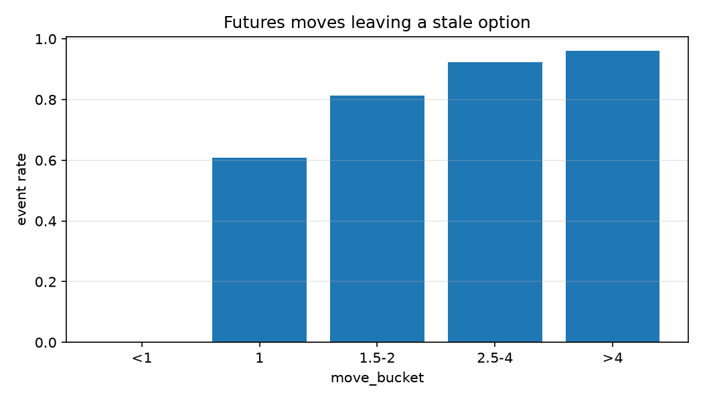
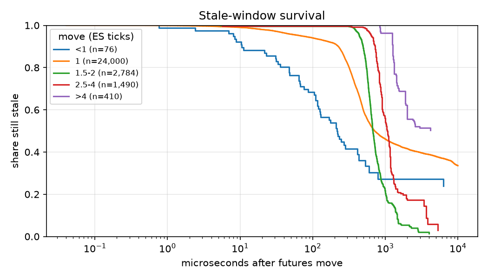

# ES 0DTE Stale Quotes: Measuring Futures-to-Options Price Adjustment

**How often do E-mini S&P 500 futures moves leave same-day-expiry option quotes economically stale—and what happens to those quotes?**

We built a reproducible, event-driven analysis using **CME Globex data from Databento (`GLBX.MDP3`)**. The main study covers **October 5–9, 2026**, using top-of-book (`mbp-1`) futures and option observations. A smaller market-by-order (`mbo`) study investigates whether stale quotes are executed, cancelled, or modified. This is an empirical market-microstructure study, **not a live trading strategy or a backtest of executable profits**.

## Key findings

| Result | Observed value |
|---|---:|
| ES futures price-move events detected (five days) | **302,485** |
| Eligible events in the opportunity analysis | **301,289** |
| Futures events with at least one economically stale option | **7,786 (2.58%)** |
| Economically stale event–option pairs | **28,760** |
| Kaplan–Meier median stale-window duration | **772 µs** |
| Overall median option reaction latency | **Not estimable** under observed censoring |

**Move size matters more than the overall average suggests.** Sub-tick futures moves produced a stale quote in just **0.03%** of eligible events. The event-level frequency rose to **60.76%** for one-tick moves, **81.42%** for 1.5–2 ticks, and **92.31%** for 2.5–4 ticks. For moves above four ticks, it reached **96.00%**, although that last bucket contains only **25 eligible futures events**. Median model-implied edge after the configured cost threshold increased from **$0.80 per contract** for one-tick moves to **$34.43** for moves above four ticks. These figures describe historical quoted prices, not guaranteed fills.



## How we measure staleness

Our pipeline selects ES futures and same-day-expiry options, downloads the relevant market data, and detects futures midpoint changes. Nearby changes are clustered to avoid counting rapid reversals as independent moves. Each event records the futures prices before and after the move, its tick size, and an observation cutoff.

For each eligible event–option pair, we recover the pre-move option bid and ask. **Black-76** inverts the pre-move midpoint to implied volatility, and a **delta-gamma adjustment** estimates the option's new fair value after the futures move. We flag an economically stale ask when `ask < fair - cost`, or a stale bid when `bid > fair + cost`. The baseline cost threshold is **0.045 option points**: half a 0.05-point option tick plus a flat **$1 taker fee per contract** at a $50-per-point multiplier. Fees are assumptions, not a reconstruction of each trader's actual costs.

A stale window ends when the stale side is repriced beyond the threshold or pulled. Otherwise, it is **right-censored** at the next raw futures midpoint change, expiration, or the configured observation limit (up to 10 ms). We use **Kaplan–Meier** estimates rather than treating censored windows as completed reactions. Of the pairs used for first-price-change latency, approximately **78.47% were censored**, so the overall median reaction latency is **not observed**. The median stale-window duration is estimable at **772 µs**, but its upper quartile is not.



## Order-level robustness check

For **October 7, 10:00–10:30 a.m. ET**, we matched **828 stale event–option pairs** across **18 option instruments** to MBO order activity. At least one fill was observed for **16 pairs (1.93%)**, cancellation activity for **216 (26.09%)**, and modification activity for **429 (51.81%)**. These participation rates overlap: a single quote can experience several types of action. In the mutually exclusive classification, **486 pairs (58.70%)** remain unclassified, principally because no qualifying action occurred before the cutoff or only partial activity was observed. For **19 recorded fills**, mean taker-signed markouts were **+$6.91 at 1 ms**, **+$5.59 at 10 ms**, and **+$2.63 at 100 ms**. This small sample is descriptive, not evidence of a deployable profit opportunity.

## Interpretation and limitations

Larger futures shocks are associated with more frequent and larger theoretical quote mispricings, but measuring a quote discrepancy is not equivalent to capturing it. Our observation windows are short and often censored; the futures and options matching engines also have clock-alignment limitations despite nanosecond timestamp fields. A historical quote may be cancelled before a strategy could reach it, and our calculations do not simulate queue position, network latency, hedging, or actual execution. Near expiry, the delta-gamma approximation can also diverge from exact repricing for larger moves.

Detailed results and methodological notes are available in [Issue 4](reports/issue4_report/summary.md), [Issue 7](reports/issue7_report/summary.md), and [Issue 8](reports/issue8_report/summary_20261007.md). The full tabular results and figures are committed under [`reports/issue7_report/`](reports/issue7_report/).

---

## Reproduce the analysis (setup and commands)

The instructions below are **not part of the 500–800-word research overview**. Run commands from the repository root. The large Databento DBN downloads and generated Parquet datasets are intentionally **not committed to GitHub**; the smaller CSV reports and PNG figures are committed so results can be inspected without re-downloading market data.

### 1. Environment and data access

Requires **Python 3.11+**, a Databento Historical API key with access to CME `GLBX.MDP3` for the study dates and required schemas, and sufficient disk space and memory. **Historical requests may incur charges**. Access and pricing depend on the reader's account; the original project's data entitlement is not transferable with this repository.

```bash
git clone https://github.com/PietroC21/Futures_Project.git
cd Futures_Project
python3.11 -m venv .venv
source .venv/bin/activate                 # Windows: .venv\Scripts\activate
python -m pip install -e .
python -m pip install -r requirements.txt
export DATABENTO_API_KEY="YOUR_KEY"       # Set in your shell; do not commit secrets
python -m pytest -q
```

### 2. Download the five-day MBP-1 sample

These commands select the ES futures/0DTE option instruments and store daily futures/options files and request manifests in `data/raw/mbp-1/YYYYMMDD/`. The cost estimate does not download the large MBP-1 files, **but instrument selection may write** `data/processed/instruments.parquet`.

```bash
python scripts/download.py --dry-run
python scripts/download.py
```

The configured study dates are October 5–9, 2026 and the strike selection is defined in `src/stale_quotes/config.py`. Review the quote before confirming the download. Reuse existing caches where possible; if you change dates, strikes, or coverage, examine the JSON manifests rather than assuming an existing DBN file matches the new request.

### 3. Generate the futures events and five-day study results

```bash
python scripts/detect_events.py
python scripts/run_study.py
```

This creates:

- `data/processed/events/YYYYMMDD/events.parquet` — Issue 4 event tables;
- `data/processed/stale/YYYYMMDD.parquet` — Issue 6 stale-quote classifications;
- `data/processed/latency/YYYYMMDD.parquet` — Issue 7 reaction latencies;
- `results/tables/*.csv` and `results/figures/*.png` — newly generated aggregate tables and figures.

To force recomputation of daily stale and latency data after changing underlying inputs, use `python scripts/run_study.py --recompute`. To examine the saved report, open `notebooks/issue7_results.ipynb` with the same Python environment. The committed reference outputs are in `reports/issue7_report/tables/` and `reports/issue7_report/figures/`.

### 4. Optional: reproduce the October 7 MBO extension

**Do this only after Step 3**, because the missing-instrument downloader determines which MBO contracts are needed from the October 7 stale-event table. The original 4-contract MBO batch and the additional contracts are requested separately; manifests prevent redundant requests for covered instrument IDs. Check the cost at both stages before proceeding.

```bash
python scripts/download_mbo_sample.py --date 2026-10-07 --n-options 4 --end-et 10:30 --dry-run
python scripts/download_mbo_sample.py --date 2026-10-07 --n-options 4 --end-et 10:30
python scripts/download_missing_mbo.py --date 2026-10-07 --start-et 10:00 --end-et 10:30 --dry-run
python scripts/download_missing_mbo.py --date 2026-10-07 --start-et 10:00 --end-et 10:30
python scripts/run_mbo_analysis.py --date 2026-10-07 --start-et 10:00 --end-et 10:30 --events data/processed/events/20261007/events.parquet
```

The MBO downloads reside in `data/raw/mbo/20261007/`. The analysis writes detailed files to `data/processed/mbo/20261007/` and small summary tables to `reports/issue8_report/`. If the repository already contains JSON manifests but the corresponding uncommitted DBN files are absent, inspect or remove those stale manifests before rerunning the relevant downloads. **Never treat an existing manifest alone as proof the market-data file is available.**

## Project implementation

| Component | Location |
|---|---|
| Instrument selection and historical downloads | `src/stale_quotes/instruments.py`, `src/stale_quotes/download.py` |
| Futures event detection | `src/stale_quotes/events.py`, `scripts/detect_events.py` |
| Black-76 valuation and stale-quote detection | `src/stale_quotes/black76.py`, `src/stale_quotes/staleness.py` |
| Latency, survival, opportunity and edge analysis | `src/stale_quotes/metrics.py`, `scripts/run_study.py` |
| Order-level MBO classification and markouts | `src/stale_quotes/mbo_analysis.py`, `scripts/run_mbo_analysis.py` |
| Tests and exploratory notebooks | `tests/`, `notebooks/` |
