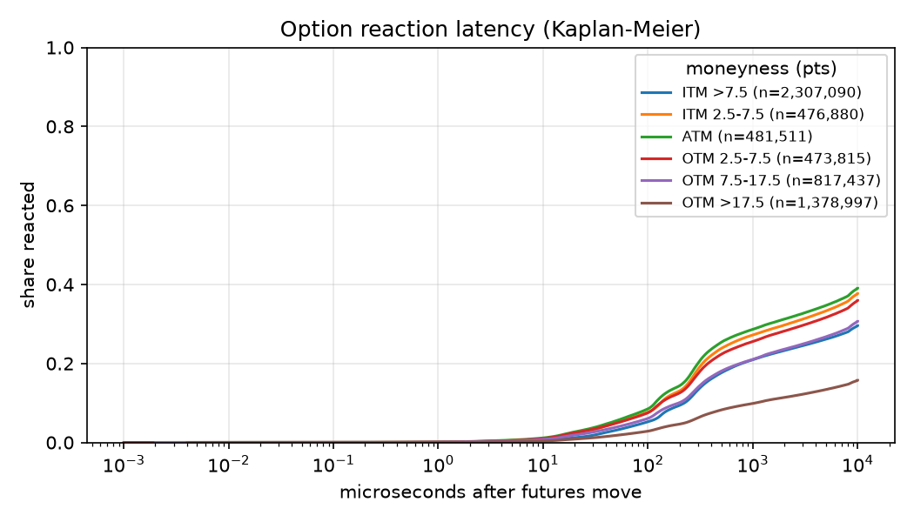
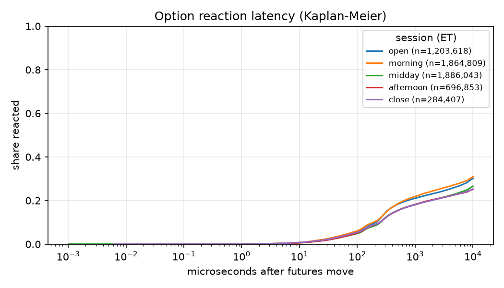
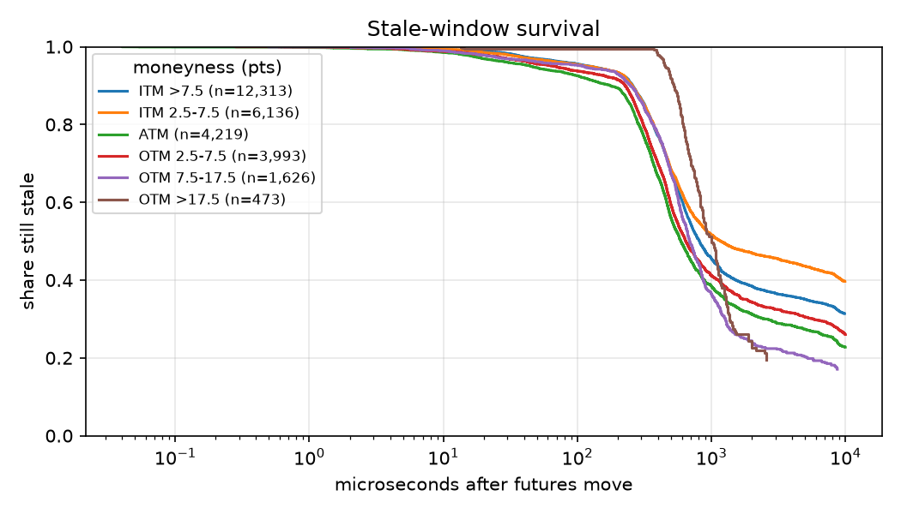
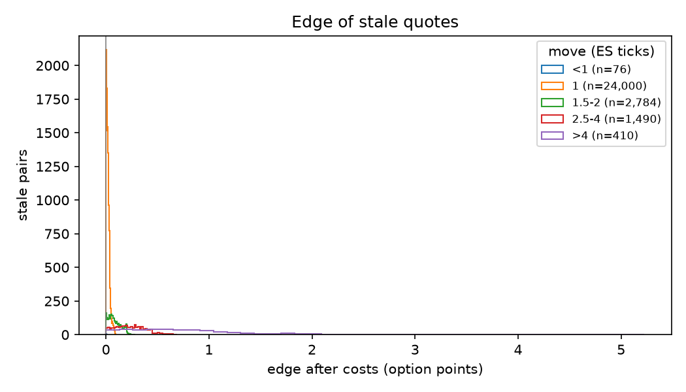

# Issue #7 — Reaction Latency, Opportunity Frequency, and Stale-Window Survival

## Overview

This report presents the empirical results of the **October 5–9, 2026** ES 0DTE options study, using Databento CME MBP-1 observations. The analysis layer developed for Issue #7 (`src/stale_quotes/metrics.py`) combines Issue #4 futures events with Issue #6's economically stale option-quote classifications, and separately measures the latency of option BBO price changes.

The objective is to answer four questions:

1. How quickly do option quotes react after ES futures move?
2. How often do futures moves leave economically stale option quotes?
3. How long do those stale windows survive?
4. How do the results vary by futures move size, moneyness, and trading session?

**Main finding.** Stale quotes are rare when averaged over all futures events, but their frequency and estimated economic edge increase sharply with the size of the futures move. Observed stale windows are short; however, heavy right-censoring limits what we can infer about overall reaction latency and the upper tail of stale duration.

## Method and Measurement Conventions

- **Sample:** October 5–9, 2026, regular trading hours. Issue #7 analyzes **301,289 eligible futures events** and **5,830,389 evaluable event–option pairs** for opportunity frequency. These differ from the broader Issue #4 count (302,485 events) and the full Issue #6 status audit (6,049,700 pairs) because the denominators have different eligibility rules.

- **Economic staleness:** A pre-move option ask is stale if `ask < fair - cost`; a bid is stale if `bid > fair + cost`. The baseline uses Issue #6's delta-gamma fair-value estimate and a **0.045-point** threshold (half an option tick plus a flat $1.00 per contract taker-fee assumption converted at $50 per point). An estimated edge is **not** a realized trade profit.

- **Reaction latency (RQ1):** Time from the futures move timestamp `t0` to the option's **first top-of-book price change**, measured for judged event–option pairs whether or not the quote is stale. Size-only updates are not reactions. **Directional latency** additionally requires the option midpoint to move in the direction predicted by delta. A quote update timestamped at `t0` has a measured latency of zero, which is tracked for the cross-engine clock check.

- **Stale-window duration (RQ3):** Time from `t0` until the stale-side quote is repriced beyond the threshold or removed. The window is cut off at the next raw futures midpoint move, the configured maximum observation window, data validity limits, or expiration. A window ending without a confirmed reaction is **right-censored**, not counted as an observed resolution.

- **Censoring:** Latency and duration quantiles, as well as survival curves, use **Kaplan–Meier** estimates. An empty quantile indicates the estimated curve never reached that probability before observation ended; it must not be read as zero. The conservative cutoff isolates each futures event rather than attributing later, overlapping moves to the original shock.

- **Breakdowns:** Futures move sizes are grouped into `<1`, `1`, `1.5–2`, `2.5–4`, and `>4` ES ticks; moneyness is grouped by signed OTM strike distance, with ATM defined relative to the nearest 5-point strike; sessions are defined in ET (open, morning, midday, afternoon, close). Pooled event counts use `(trading_date, event_id)` to avoid collisions across dates.

## 1. How Often Do Futures Moves Create Stale Quotes?

Across **301,289 eligible futures events**, **7,786 events (2.58%)** left at least one option quote economically stale. There were **28,760 stale pairs**, or **0.49%** of the 5,830,389 evaluable event–option pairs.

The two rates use different denominators: one futures event with several stale option strikes counts **once** in the event-level rate.

| Futures move (ES ticks) | Eligible events | Events with ≥1 stale quote | Event-level stale rate | Stale pairs |
|---|---:|---:|---:|---:|
| <1 | 288,768 | 76 | 0.03% | 76 |
| 1 | 12,096 | 7,349 | 60.76% | 24,000 |
| 1.5–2 | 296 | 241 | 81.42% | 2,784 |
| 2.5–4 | 104 | 96 | 92.31% | 1,490 |
| >4 | 25 | 24 | 96.00% | 410 |
| **Overall** | **301,289** | **7,786** | **2.58%** | **28,760** |

Sub-tick moves dominate the denominator but almost never create qualifying opportunities. In contrast, stale quotes occur after **60.76% of one-tick events** and most larger moves.

The **>4-tick group includes only 25 eligible events**, so its high rate should not be interpreted as a precise population estimate.

By ET session, the event-level stale rate is:

| Session | Event-level stale rate |
|---|---:|
| Open | 1.94% |
| Morning | 3.64% |
| Midday | 1.89% |
| Afternoon | 2.91% |
| Close | 2.27% |

Moneyness-specific denominators and rates are reported in `tables/opportunity_moneyness.csv`.


## 2. How Quickly Do Option Quotes React?

The first-price-change analysis includes **5,935,730 pairs**. **78.47%** are censored before a qualifying price update is observed.

The Kaplan–Meier estimates are:

| Measure | First-price-change latency | Directional latency |
|---|---:|---:|
| Censored share | 78.47% | 79.38% |
| KM 10th percentile | 224 µs | 236 µs |
| KM 25th percentile | 5,013 µs | 6,817 µs |
| KM median | Not reached | Not reached |

The **overall median reaction latency cannot be estimated** from the available observation windows.

These latency calculations do not condition on a quote having been identified as stale, which avoids selecting only the options that show economically significant mispricing.

### Latency by Futures Move Size

| Futures move (ticks) | Latency pairs | KM median first-price-change latency | Censored share |
|---|---:|---:|---:|
| <1 | 5,694,426 | Not reached | 78.96% |
| 1 | 233,124 | Not reached | 67.58% |
| 1.5–2 | 5,709 | 677 µs | 48.75% |
| 2.5–4 | 1,985 | 955 µs | 34.81% |
| >4 | 486 | 1,860 µs | 43.62% |

The latency split also varies by moneyness. The **ATM 10th percentile is 117 µs**, compared with **1,057 µs** for options more than 17.5 points OTM.

However, the far-OTM group is also **88.58% censored**. These differences should therefore be interpreted as descriptive comparisons under unequal censoring and observation coverage, rather than direct evidence about exchange processing speed.

Futures and options trade on separate matching engines. As established in Issue #1, nanosecond timestamp precision does not guarantee nanosecond synchronization accuracy across engines.





## 3. How Long Do Stale Windows Survive?

Among the **28,760 economically stale pairs**, **47.01%** are censored.

The Kaplan–Meier duration estimates are:

| Statistic | KM stale-window duration |
|---|---:|
| 10th percentile | 244 µs |
| 25th percentile | 399 µs |
| Median | 772 µs |
| 75th percentile | Not reached |
| 90th percentile | Not reached |

### Duration by Futures Move Size

| Futures move (ticks) | Stale pairs | KM median duration | Censored share |
|---|---:|---:|---:|
| <1 | 76 | 215 µs | 34.21% |
| 1 | 24,000 | 710 µs | 48.60% |
| 1.5–2 | 2,784 | 673 µs | 35.17% |
| 2.5–4 | 1,490 | 1,060 µs | 39.40% |
| >4 | 410 | Not reached | 64.39% |

The missing median for the largest moves is important. Under the conservative next-futures-move cutoff, too few windows in that group are definitively resolved to estimate a typical survival time.

A cumulative-move model could be considered as a future robustness check, but it would introduce additional assumptions about attributing quote reactions to overlapping futures shocks.

For this study, we retain censoring at the next futures move as the primary approach, consistent with Issues #4 and #6.




## 4. How Does the Estimated Economic Edge Vary?

Across economically stale pairs, the mean model-implied edge after the configured threshold is **0.0503 option points ($2.52 per contract)**, while the median is **0.0190 points ($0.95 per contract)**.

Estimated edge increases substantially with futures move size.

| Futures move (ticks) | Stale pairs | Median edge ($/contract) |
|---|---:|---:|
| <1 | 76 | $0.09 |
| 1 | 24,000 | $0.80 |
| 1.5–2 | 2,784 | $3.63 |
| 2.5–4 | 1,490 | $11.46 |
| >4 | 410 | $34.43 |

The results suggest that the economically interesting deviations are concentrated in larger futures moves, even though these events are relatively rare.

However, these are **theoretical quote-level deviations, not executable trading P&L**.

The model does not account for queue priority, order-entry latency, realized execution probability, additional hedging costs, or the market impact of taking liquidity.

Similarly, aggregating estimated edge across displayed quote sizes should not be interpreted as a backtested portfolio return.



## 5. Data Quality and Interpretation

The complete status audit contains **6,049,700 event–option pairs**, including cases excluded from the evaluable opportunity-rate denominator.

The overall status distribution is approximately:

| Status | Share of all pairs |
|---|---:|
| `not_stale` | 95.90% |
| `stale` | 0.48% |
| `invalid_quote` | 1.88% |
| `below_intrinsic` | 1.72% |
| Other IV/quote failures | Remaining share |

The `status_<split>.csv` tables make it possible to inspect these outcomes by futures move size, moneyness, and session.

This is particularly useful for understanding whether the filtering process systematically excludes certain options or periods of the day.

### Close-Session Filtering

The close session shows unusually high rates of invalid or unreliable inputs.

According to `tables/status_session.csv`:

- **27.68%** of all close-session pairs are `invalid_quote`.
- **16.71%** are `below_intrinsic`.

These shares are much higher than earlier in the trading day.

Consequently, the reported close-session stale rate applies to the **eligible sample**, not every observed option quote. Session-level and moneyness-level comparisons should be interpreted alongside the corresponding observation counts, status distributions, and censoring rates.

### Main Limitations

**1. Cross-engine clock synchronization**

Futures and options are processed by different matching engines. Measured microsecond-level latencies may be affected by timestamp alignment, as discussed in Issue #1.

**2. Right-censoring**

The next futures midpoint move often arrives before an option quote reaction can be conclusively observed. This limits estimates of median reaction latency and longer stale-window durations.

**3. Transaction-cost assumptions**

The baseline uses a flat $1.00-per-contract taker fee and half an option tick as an additional cost allowance. Actual fees and execution costs depend on trading arrangements.

**4. Fair-value approximation**

The baseline uses a delta-gamma approximation. For large futures moves close to expiry, higher-order effects may matter, and exact Black-76 repricing could be a useful robustness check.

**5. Sample period and execution feasibility**

The study covers five trading days and identifies historical quote-level opportunities rather than implementing a live trading strategy.

Issue #8 separately investigates observed order-level cancellations and fills using a smaller MBO sample. Those results provide additional context, but they do not turn the MBP-1 estimates into realized profits.

## Implementation and Reproduction

The core analytical logic lives in reusable Python modules rather than the notebook.

| Component | Responsibility |
|---|---|
| `src/stale_quotes/metrics.py` | Reaction latency, opportunity frequency, duration and edge summaries, status diagnostics, Kaplan–Meier estimates, grouped results and figures |
| `scripts/run_study.py` | Runs the daily stale-quote and latency analysis, caches results, and generates aggregate outputs |
| `notebooks/results.ipynb` | Loads and displays saved tables and figures |
| `tests/test_metrics.py` | Unit and integration tests, including censored Kaplan–Meier cases |

The pipeline uses the following intermediate outputs:

- `data/processed/events/YYYYMMDD/events.parquet` — Issue #4 futures events.
- `data/processed/stale/YYYYMMDD.parquet` — Issue #6 economically stale quote classifications.
- `data/processed/latency/YYYYMMDD.parquet` — Issue #7 reaction latency observations.

The final analysis outputs are written to:

- `results/tables/*.csv`
- `results/figures/*.png`

### Running the Analysis

From the repository root, after installing dependencies and preparing the Issue #2/#3 input data and Issue #4 futures events:

```bash
python scripts/run_study.py \
  --dates \
  2026-10-05 \
  2026-10-06 \
  2026-10-07 \
  2026-10-08 \
  2026-10-09
```

Make sure the `--events` argument resolves to the actual Issue #4 cache location:

```text
data/processed/events/YYYYMMDD/events.parquet
```

Older branches used the obsolete `issue4_report/{date}/events.parquet` default.

After the run completes, execute `notebooks/results.ipynb` to display the results.

The tables and figures included alongside this report are stored under:

```text
issue7_report/
├── summary.md
├── tables/
│   ├── opportunity_*.csv
│   ├── latency_*.csv
│   ├── directional_latency_*.csv
│   ├── duration_*.csv
│   ├── edge_*.csv
│   └── status_*.csv
└── figures/
    ├── opportunity_rate_by_move.png
    ├── latency_by_moneyness.png
    ├── latency_by_session.png
    ├── survival_by_move.png
    ├── survival_by_moneyness.png
    └── edge_by_move.png
```

For detailed denominators, censoring rates, eligibility checks, and group-level sample sizes, refer to the accompanying CSV tables.

---

*All empirical numbers in this report are based on the October 5–9 output tables. Rounded display values may differ slightly from unrounded CSV values.*
